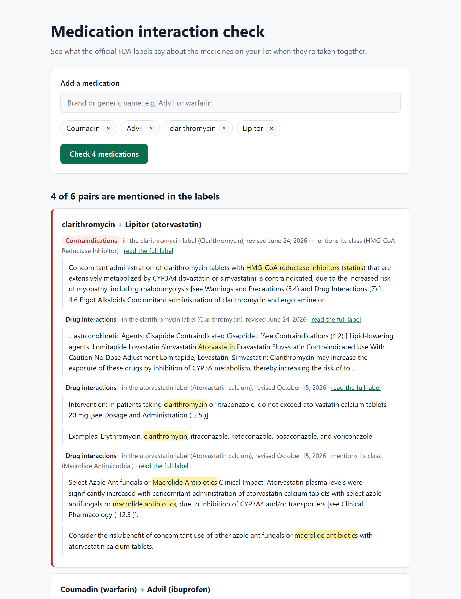

# Medication interaction check

Type the medicines someone takes, brand or generic, and see what the official FDA drug labels say about taking them together. Every finding is a direct quote from a label, with a link to the full label. Nothing is paraphrased or scored.

**Live:** https://rx-interaction-checker.vercel.app



> This is an educational tool, not medical advice. Labels can describe interactions in ways a text search can't catch, so a pharmacist or doctor should always review a medication list.

## What it checks

For every pair of medicines on the list, it looks in **both** drugs' FDA labels for the other drug:

| Label section | Why it matters | Shown as |
|---|---|---|
| Boxed warning | The FDA's strongest warning | Red, listed first |
| Contraindications | Combinations the label says not to use | Red, listed first |
| Drug interactions | Combinations to use with care, adjust or monitor | Listed after |

The two directions differ in practice. Warfarin's label lists ibuprofen, but ibuprofen's label doesn't name warfarin.

It also catches:
- **Mentions by class.** Labels often say "NSAIDs" or "HMG-CoA reductase inhibitors (statins)" instead of naming each drug. Each drug's official FDA class comes from RxClass, and the common wordings for about a dozen classes are matched too. Class matches are labelled as such.
- **The same ingredient twice.** "Advil" and "ibuprofen", or Tylenol and Excedrin (both contain acetaminophen), can double a dose. No label comparison can flag that, so it's checked separately.

## Where the data comes from

| Source | Used for |
|---|---|
| [RxNorm](https://lhncbc.nlm.nih.gov/RxNav/) (US National Library of Medicine) | Suggestions as you type, and turning names into active ingredients: Lipitor becomes atorvastatin |
| [RxClass](https://lhncbc.nlm.nih.gov/RxNav/APIs/RxClassAPIs.html) | Each ingredient's FDA Established Pharmacologic Class |
| [openFDA drug labels](https://open.fda.gov/apis/drug/label/) | The newest prescribing label for each ingredient, preferring single-ingredient labels over combinations |

The NIH's own interaction API was retired in January 2024, so this app works from the labels themselves. All requests go straight from the browser to these public APIs. There's no server, and only drug names are sent. A Content Security Policy restricts the page to those two API hosts.

## Things it does to be dependable

- **Shows the drug name in every quote.** Label "sentences" are often long tables, so quotes are trimmed to a window around the match instead of being cut off before it.
- **Matches names safely.** Matching is whole-word, so "aspirin" doesn't match inside a longer word. Names too short to match safely are ignored. Before that rule was added, an empty search pattern matched every sentence; a test caught it.
- **Polite to the APIs.** At most four requests run at once. Requests that get HTTP 429 or 503 are retried with backoff, and results are cached for the session.
- **Copy a summary.** A plain-text summary for a pharmacist lists every quote with its source and label date.
- **Lists stay on the device.** The current list is kept in the URL, so it can be shared, and recent lists are remembered in this browser only.

## Tests

```bash
npm install
npm test            # 33 unit and component tests
npm run test:e2e    # 10 browser tests (5 scenarios on desktop and mobile)
npm run fixtures    # re-record the API responses the browser tests use
```

- **Unit tests** cover sentence matching and excerpts, the API clients (with a mocked `fetch`), label selection, pair ranking, class matching, duplicate ingredients, retries and concurrency, the summary text, and recent lists.
- **Component tests** drive the real UI: keyboard selection in the search box, the URL round trip, and error handling.
- **Browser tests** use real recorded RxNorm and openFDA responses, so they run offline. They include an axe accessibility scan before and after a check.

## Run locally

```bash
npm install
npm run dev
```

Built with React 19, TypeScript and Vite. There's no UI library: the search box is a hand-built ARIA combobox.

## License

[MIT](LICENSE)
